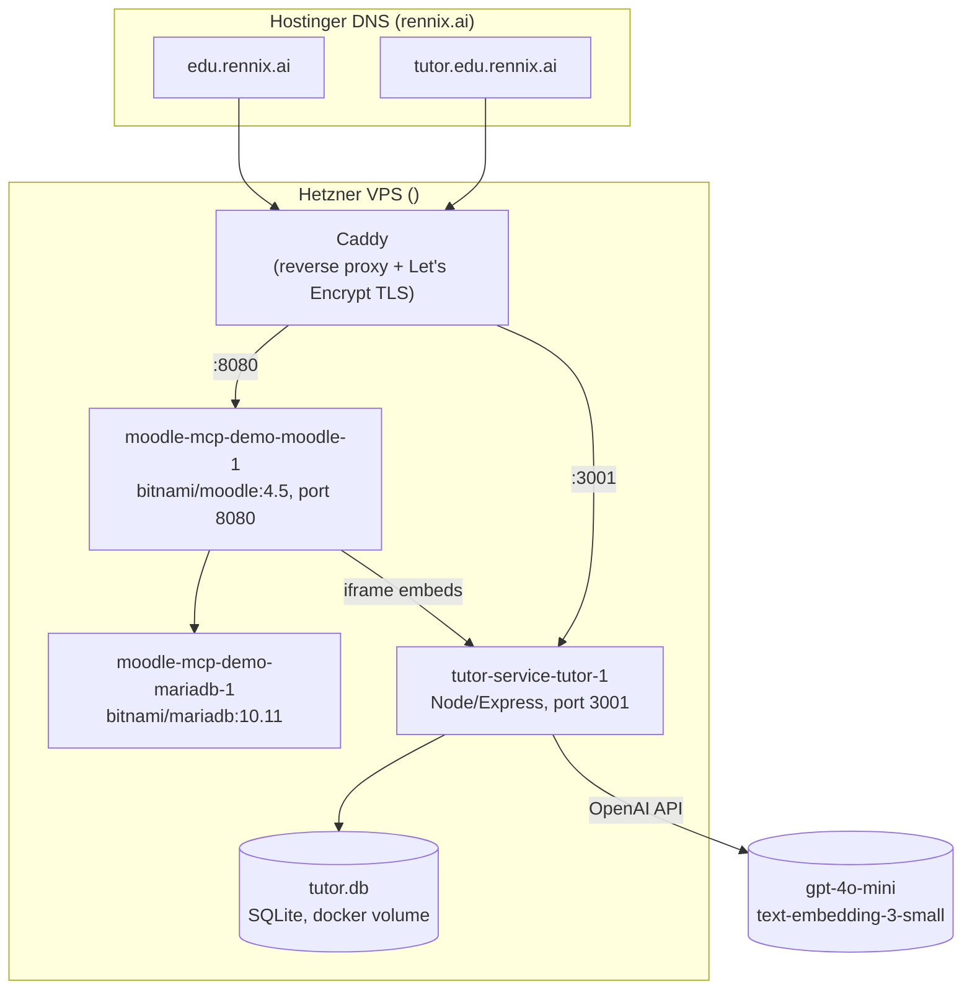

# HTU Criterio Pilot — Architecture

A Moodle-based clone of Rennix AI's "Criterio" formative-learning platform, built for Al-Hussein
Technical University's CS101 (Programming Fundamentals) summer pilot. Moodle handles auth,
enrollment, courses, and content hosting; a standalone Node service (`tutor-service`) bolts on
everything Moodle doesn't do natively — AI tutoring, engagement analytics, attendance,
formative sessions, and a full custom student/instructor UI shell that iframes into Moodle pages.

Reference product studied for feature parity: `github.com/FerasJalal/criterio` (private mirror of
`MutazMalhis/criterio`, the real Next.js + Supabase Criterio app). Cloned locally during this
project for architecture lookups — not part of this repo.

## 1. System overview



- **`edu.rennix.ai`** → Caddy → `localhost:8080` → Moodle (real course content, auth, grading,
  the `block_criterio` plugin).
- **`tutor.edu.rennix.ai`** → Caddy → `localhost:3001` → tutor-service (everything else: AI
  tutors, the whole student/instructor app shell, analytics, attendance).
- Moodle pages embed tutor-service pages/widgets via `<iframe>` (see `block_criterio.php`); the
  reverse direction (tutor-service calling Moodle) happens only through a handful of one-off admin
  scripts (student sync, quiz-grade sync), not at request time.
- Neither container is bind-mounted to local source — every deploy is `scp server.js` →
  `docker compose build tutor && docker compose up -d tutor` on the VPS (see §8).

## 2. Identity & authorization

Every tutor-service route used to trust a bare `?student=`/`?as=` query param or a
`student_userid` in the POST body as-is — confirmed live as a real vulnerability: `GET
/app/home?student=8` rendered that student's full dashboard from a completely unauthenticated
browser, no Moodle login required. None of the newer instructor routes (Content/Analytics/
Attendance tabs, roster, module-analysis, student profile) had a role check either — reachable by
anyone who knew the URL.

**Fixed** via a signed-token handoff instead of a bare id:

1. `block_criterio.php` (Moodle, server-side, trusted — has the real `$USER->id`) signs a
   short-lived token: `base64url(json{userid, exp}) + '.' + base64url(HMAC-SHA256(payload, secret))`,
   using a secret shared with tutor-service (`block_criterio/identitysecret` config ↔
   `IDENTITY_SECRET` env var — must match exactly).
2. The token is sent via the existing postMessage identify handoff (`{type:'identify', userId,
   token}`) instead of a bare `userId`.
3. tutor-service's client-side `onIdentified` handlers append it to the redirect as `&t=`.
4. A single global Express middleware verifies `req.query.t` (or an existing `identity` cookie),
   sets an `HttpOnly`/`Secure`/`SameSite=Lax` session cookie on success, and **overwrites**
   `req.query.student`, `req.query.as`, and `req.body.student_userid` with the verified value (or
   blanks them out if unverified) — every existing route, unchanged, automatically stops trusting
   anything the client merely claims.
5. `requireInstructor` middleware (checks `students.role`) gates every instructor-only route.

This is Moodle-specific (mirrors `block_criterio`'s trust model) and deliberately separate from
`rennix-lti`'s verification (JWT + JWKS, LMS-agnostic, §… in that repo) — different trust
boundary, different protocol, not meant to converge.

## 3. Repositories / where things live

| What | Where | Notes |
|---|---|---|
| tutor-service source | `github.com/FerasJalal/moodle-tutor-service`, branch `htu-pilot-full-build` | This repo. Never merged to `main`. |
| Moodle + `block_criterio` plugin | Only inside the `moodle-mcp-demo-moodle-1` container on the VPS (`/bitnami/moodle/blocks/criterio/`) | Not git-tracked locally. Edited via one-off PHP scripts run through `docker exec`. |
| Moodle/Caddy compose files | `/root/moodle-mcp-demo/docker-compose.yml`, `/etc/caddy/Caddyfile` on the VPS | Not git-tracked. |
| Criterio reference app (read-only, for architecture lookups) | Cloned locally to the session scratchpad from `FerasJalal/criterio` | Not part of this repo; re-clone if needed for future feature parity checks. |

## 4. tutor-service file map

```
tutor-service/
├── server.js            5,776 lines — the entire backend: schema, migrations, every route,
│                         every HTML page (server-rendered template strings, no frontend build step)
├── widget.html           Ask AI chat iframe embedded on each lecture page (course-widget.html
│                         is the course-wide variant embedded on the course page)
├── course-widget.html    Ask AI chat iframe for course-wide questions (not lecture-scoped)
├── Dockerfile             node:20-alpine, copies server.js + the two widget HTML files, volumes /data
├── docker-compose.yml     single `tutor` service, port 3001, `tutor_data` named volume → /data/tutor.db
├── package.json           express, better-sqlite3, openai, cors, pdf-parse
├── .env / .env.example    OPENAI_API_KEY
└── README.md              short intro (outdated re: feature list — this file is the source of truth)
```

No build step, no frontend framework — every page in `server.js` is a template-literal string of
HTML/CSS/vanilla JS returned directly from an Express route. Client-side interactivity (tab
switching, search filters, modals) is small inline `<script>` blocks per page, not a shared bundle.

## 5. Database schema (SQLite, `better-sqlite3`, file at `/data/tutor.db`)

All tables are created with `CREATE TABLE IF NOT EXISTS` at startup; new columns are added via
guarded `ALTER TABLE` migrations (`PRAGMA table_info` check before altering) so the same
`server.js` can boot against an old or fresh database without a separate migration step.

| Table | Purpose |
|---|---|
| `lectures` | One row per video or PDF material (`lecture_id` like `week5-video3`, or `pdf-7`) |
| `chunks` | Transcript/PDF text chunks + embeddings for RAG, with `start_time`/`end_time` for timestamp grounding |
| `students` | Synced mirror of Moodle users (`userid`, `username`, `fullname`, `role`, `section`) — **not** its own auth |
| `events` | Append-only log: video progress (`heartbeat`/`pause`/`ended`/`seek`) and `chat_message` interactions, keyed by `lecture_id` (see below for the `lecture_id` convention used to tell bots apart) |
| `grades` | Synced Moodle quiz percentage per student |
| `notes` | Per-student, per-lecture, timestamp-anchored notes |
| `sessions` / `session_bookings` / `session_summaries` | Bookable formative sessions, bookings, AI-generated pre-session summaries |
| `popup_questions` / `popup_responses` | In-video and end-of-video knowledge-check questions (AI-generated, faculty-approved) and student answers |
| `assignments` / `assignment_drafts` | Assignment briefs + rubrics, and each student's own draft |
| `formative_escalations` | Formative Bot Q&A where the AI judged the student still needs instructor help; `verifier_reviewed` fields for QC sign-off |
| `pdf_materials` / `pdf_annotations` / `pdf_ink_strokes` | Slide deck source bytes, text notes, and freehand ink drawings per page |
| `lecture_questions` / `lecture_question_replies` | Per-lecture Q&A board (student-posted questions, instructor/AI replies) |
| `chat_rate_events` | Per-student rate limiting for AI endpoints |
| `app_settings` | Misc key/value (model config selection) |
| `chat_feedback` | 👍/👎 on individual AI replies |
| `ai_errors` | Logged provider failures (timeout/rate-limit/etc.), feeds the (now removed from UI) evaluation stats |
| `course_sections` | The multi-instructor model: section `key`/`title`/`instructor_userid` (real data, not Moodle groups) |
| `question_review_status` | Mark-addressed/dismissed state for "questions worth revisiting" in Analytics |
| `course_settings` | Key/value: course guidelines text, attendance policy (enabled/threshold/max absences) |
| `chapter_settings` | Per-chapter (`week4`/`week5`/`week6`/`week7`) `due_date` and `visible` flag |

### `lecture_id` naming convention (used everywhere as an implicit foreign key / category tag)

- `weekN-videoM` — a real lecture video (e.g. `week5-video3`)
- `pdf-N` — a slide deck, `N` = `pdf_materials.id`
- `course` — the course-wide Tutor Bot's pseudo-lecture-id (not a real `lectures` row)
- `assignment-N` — Assignment Assistant chat, `N` = `assignments.id`
- Formative Bot does **not** use `events`/`lecture_id` at all — it writes to `formative_escalations` directly

This convention is how `events` rows get bucketed into the five "AI questions" categories on the
Analytics tab without a separate `bot_type` column.

## 6. Route map (`server.js`)

Grouped by feature area; line numbers as of this doc's writing (will drift as the file grows).

### System / ingestion
`/health`, `/admin/model-config` (get/post), `/students/sync`, `/track`, `/ingest`,
`/ingest-segments`, `/pdf/ingest`, `/pdf/ingest-text`, `/pdf/:id/file`, `/pdf/annotations`,
`/pdf/ink*`, `/pdf/:id`

### AI chat endpoints (the five "bots")
- `POST /chat` — lecture-scoped Ask AI (RAG over that video's transcript chunks)
- `POST /chat/course` — course-wide Tutor Bot (grounded in guidelines + material index)
- `POST /chat/formative` — Formative Bot (assignment-brief-grounded, writes `formative_escalations`)
- `POST /chat/assistant` — Assignment Assistant (brief + rubric + the student's own draft)
- PDF Ask AI reuses `/chat` with a `pdf-N` lecture_id
- `POST /feedback` — 👍/👎 on a chat reply

### Student app shell
`/app/home`, `/app/courses`, `/app/course/cs101`, `/lecture/:id`, `/widget/:lectureId`,
`/widget/course/chat`, `/notes*`, `/qa/*` (per-lecture Q&A board), `/assignments/mine`,
`/students/lookup`, `/grades/sync`

### Leaderboard
`/leaderboard`, `/leaderboard/embed` (compact version for the Moodle `block_criterio` iframe)

### Sessions / Smart Invite
`/sessions` (list + create), `/sessions/:id/book`, `/sessions/smart-invite`,
`/sessions/:id/invite`, `/sessions/:id/generate-summary`, `/sessions/:id/summary*`

### Knowledge-check questions (pop-ups)
`/quiz/generate/:lectureId`, `/quiz/review*`, `/popups/create`, `/popups/lecture`,
`/popups/respond`, `/popups`

### Assignments / workspace
`/assignments/create`, `/assignments/parse-brief`, `/assignments/new`, `/assignments`,
`/drafts/*`, `/assignments/:id/rubric`, `/workspace/:assignmentId`

### Internal Verifier (QC layer, separate from instructor)
`/verifier`, `/formative/escalations`, `/formative/escalations/:id/review`

### Instructor — current app (`/app/instructor`, tabbed)
- `GET /app/instructor?tab=overview|content|analytics|attendance` — single route, tab switch via query param
- **Overview**: `renderCourseOverviewSection` + `buildCourseSupervisorOverview()`
- **Content**: `renderContentTab` + `buildContentTabData()`, plus `/content/import-students`,
  `/content/guidelines`, `/content/chapter/:key/visibility`, `/content/chapter/:key/due-date`,
  `/instructor/roster`
- **Analytics**: `renderAnalyticsTab` + `buildAnalyticsTabData()`, plus
  `/instructor/module-analysis`, `/instructor/student`, `/analytics/question/:id/address`,
  `/analytics/question/:id/dismiss`
- **Attendance**: `renderAttendanceTab` + `buildAttendanceData()`, plus `/attendance/policy`,
  `/attendance/export.csv`

### Instructor — legacy (dead code, not linked from anywhere live)
`/instructor`, `/instructor/section`, `/instructor/detail` — the pre-tab-redesign dashboard.
Kept only because nothing currently breaks by leaving it; safe to delete in a future pass.

## 7. Feature inventory

### Student-facing
- Home dashboard, My Courses, course detail page (chapters + progress), lecture page (video +
  collapsible sidebar + Ask AI + notes + Q&A + knowledge-check questions)
- Four AI assistants: lecture Ask AI, course-wide Tutor Bot, Formative Bot, Assignment Assistant
- Guide Me / Check Me learning journeys (modes on the lecture Ask AI)
- PDF/slide viewer with ink annotations
- Leaderboard, bookable formative sessions, per-lecture Q&A board, timestamped notes
- Assignment workspace (brief + rubric + AI-assisted draft editor)

### Instructor-facing (`/app/instructor`, 4 tabs — rebuilt to match real Criterio, see §9)
- **Overview**: course-wide performance stats + per-section cards (avg watched, videos watched,
  tutor bot messages, escalations; "Needs attention"/"Highest engagement" badges)
- **Content**: sections/roster access, bulk student roster import, assignments list, editable
  course guidelines, chapters with Hide/Show + attendance due dates + per-video Analytics links
- **Analytics**: who needs you, questions worth revisiting (with mark-addressed/dismissed
  workflow), student lookup, per-module analysis (completion by section/video, weekly
  interactions), AI question log by bot type, leaderboard
- **Attendance**: engagement-derived absence tracking (HTU policy: every two non-engaged due
  chapters = one absence, 5 allowed before disqualified), policy settings, CSV export

### Other
- Internal Verifier role — QC sign-off on Formative Bot escalations and AI session summaries,
  separate from the instructor
- Smart Invite — rules-based flagging of students to invite to formative sessions

## 8. Deployment

No CI/CD — manual scp + rebuild:

```bash
scp -i ~/.ssh/htu_hetzner server.js root@<server-ip>:/root/tutor-service/server.js
ssh -i ~/.ssh/htu_hetzner root@<server-ip> \
  "cd /root/tutor-service && docker compose build tutor && docker compose up -d tutor"
```

Moodle-side changes (theme CSS/JS, config, one-off data fixes) go through a PHP script written
locally, scp'd to the server, `docker cp`'d into the Moodle container, run via
`docker exec -u daemon moodle-mcp-demo-moodle-1 php /bitnami/moodle/<script>.php`, then deleted.
This is the only way Moodle config/theme changes are made — there is no Moodle admin UI click-ops
in this project's history.

## 9. Provenance note on the instructor tabs

The Overview/Content/Analytics/Attendance tabs were originally built from screenshots of the real
Criterio product (`criterio.rennix.ai`) before repo access was available, which led to some
invented content with no real counterpart (a "Section Performance" ranking, a "Student
Performance" table, "Most Asked Questions", and an "Evaluation"/AI-quality dashboard on the
Overview tab). Once `FerasJalal/criterio` was cloned, all four tabs were re-audited against the
actual source (`getSupervisorOverview.ts`, `getCourseContent.ts`, the instructor `analytics/page.tsx`,
`calculateAttendance.ts`, `bulkImportStudents.ts`) and the invented sections were removed. Content,
Analytics, and Attendance were confirmed to already match; Overview was rebuilt from
`IVSupervisorDashboard.tsx`.

## 10. Known gaps / not-yet-built

Fixed since the first version of this doc:
- ~~Quick-login demo buttons~~ — removed from the Moodle login page footer (the HTU logo
  injection script was left in place).
- ~~Content tab missing Course Tutor Bot prompt editor + knowledge base~~ — added: an
  "Instructor guidance" field (appended to the `/chat/course` system prompt) plus a
  `tutor_knowledge_sources` table (paste-text or upload .txt/.md, concatenated into the same
  prompt, capped at 12k chars). Simplified vs. the real product: no per-source embedding/RAG
  retrieval, no remote-URL ingestion (SSRF surface not worth it for a pilot), no PDF extraction
  in this specific flow (lecture PDFs already have their own ingestion path).
- ~~Content tab missing Formative Bot escalations panel~~ — added, reusing the existing
  `formative_escalations` table with a real Mark resolved/unresolved toggle.
- ~~Legacy `/instructor`, `/instructor/section`, `/instructor/detail` dead routes~~ — deleted,
  along with the helper functions (`sectionKeyOf`, `sectionTitleOf`, `looksLikeGap`,
  `CONTENT_GAP_PHRASES`) that were only used by them.
- ~~Identity spoofing via `?student=`/`?as=`~~ — fixed, see §2 (Identity & authorization).

Still open:
- No non-root SSH user on the Hetzner box.
- Only 1 of 52 lecture videos is actually Vimeo-hosted; the rest are local files.
- Weeks 9–14 content on hold per earlier instruction.
- Self-hosted LLM deployment blocked on GPU hosting.
- No `local_criterio` Moodle provisioning plugin; no cohort/A-B assignment logic.
- `/verifier`, `/formative/escalations`, `/quiz/review`, `/popups/create` and similar older
  instructor tooling still have no role gate (predates the `students.role` model and wasn't in
  scope for the §2 fix — same category of risk, lower priority since they don't leak
  per-student personal data the way the fixed routes did).
- The `/students/lookup` `isInstructor` exemption from the §2 fix is unexercised by any current
  caller — fine today, but means it's untested if something starts relying on it.
